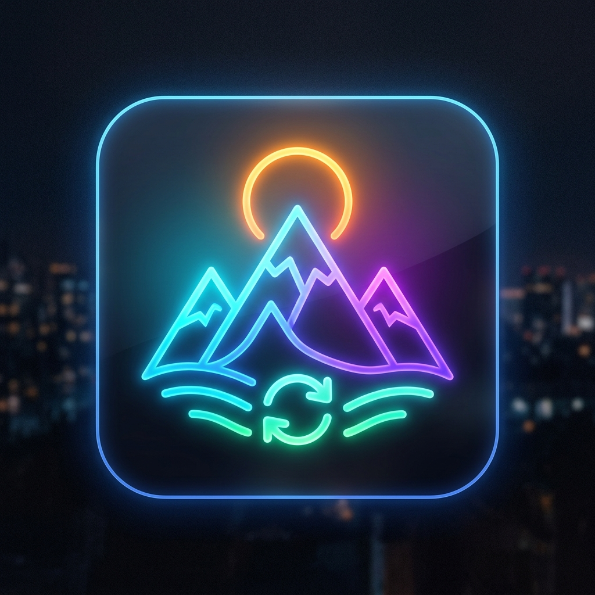

# Wallpaper Sync (v5.1.0) 🌄✨

<p align="center">
  
</p>

<p align="center">
  <strong>A lightning-fast, ultra-low-memory Windows desktop companion that curates, rotates, and synchronizes 4K wallpapers effortlessly.</strong>
</p>

<p align="center">
  <a href="https://github.com/Debanjan110d/wallpaper-sync-app/releases">
    
  </a>
  &nbsp;
  
  &nbsp;
  
  &nbsp;
  
</p>

---

## 💡 What is Wallpaper Sync?

Wallpaper Sync is designed for people who love beautiful desktops without the resource bloat. Most wallpaper software constantly consumes hundreds of megabytes of RAM and runs dozens of background processes. 

Wallpaper Sync flips the script: it runs quietly in your Windows system tray, maintains a curated cloud library of vibrant 4K and 5K wallpapers, automatically extracts dominant hues to theme your desktop interface, and uses a specialized native thumbnail pipeline that drops active memory consumption by over **90%**.

---

## 🚀 Key Features

- **⚡ Ultra-Low Memory Footprint**: Uses Electron's native image scaling to generate lightweight 380px grid thumbnails, slashing renderer memory from 264 MB down to ~65 MB. When minimized to the tray, it automatically sweeps caches down to **~35-45 MB**.
- **🎨 Dynamic Adaptive Ambient Hue**: Reads the dominant color profile of whichever wallpaper is currently playing and gently tints the UI glow and borders to match the artwork.
- **🌗 Dual Handcrafted Themes**:
  - **Deep Plum Dark Mode**: Velvet midnight canvas (`#2C2C2C`), plum surfaces (`#612D53`), and rose highlights (`#853953`).
  - **Warm Terracotta Light Mode**: Cream canvas (`#FFEAD3`), soft mint accents (`#BFE7EA`), and rust buttons (`#D46743`).
- **🔄 Two-Stage Resilient Cloud Sync**:
  - **Stage 1 (Metadata)**: Downloads collections, tags, titles, and color metadata in milliseconds.
  - **Stage 2 (4K Wallpapers)**: Streams high-resolution files with an HTTP keep-alive connection pool, concurrency limit of 3, and atomic temporary-file swapping.
- **🔔 Native Windows Toast Notifications**: Integrated directly with Windows Action Center (`AppUserModelID`) to alert you when fresh wallpapers drop or when an update is available.
- **⌨️ Comprehensive Keyboard Shortcuts**: Instant controls for searching (`Ctrl+K`), playing/pausing (`Space` / `Alt+S`), toggling the sidebar (`Ctrl+B`), opening settings (`Ctrl+,`), and more.
- **🛡️ 1-Click Diagnostics & Health Check**: Built-in self-healing engine verifies write permissions, checks API connectivity, repairs metadata mismatches, and cleans cache.

---

## ⌨️ Keyboard Shortcuts

| Shortcut | Action |
| :--- | :--- |
| <kbd>Ctrl</kbd> + <kbd>K</kbd> | Focus global wallpaper search |
| <kbd>Space</kbd> or <kbd>Alt</kbd> + <kbd>S</kbd> | Play / Pause wallpaper slideshow |
| <kbd>→</kbd> or <kbd>Alt</kbd> + <kbd>N</kbd> | Skip to next wallpaper immediately |
| <kbd>Alt</kbd> + <kbd>R</kbd> | Apply a random wallpaper |
| <kbd>Alt</kbd> + <kbd>F</kbd> | Favorite / unfavorite current wallpaper |
| <kbd>Ctrl</kbd> + <kbd>B</kbd> | Toggle left navigation sidebar |
| <kbd>Ctrl</kbd> + <kbd>Shift</kbd> + <kbd>B</kbd> | Toggle right control studio |
| <kbd>Ctrl</kbd> + <kbd>,</kbd> | Open Settings & Cloud Sync modal |
| <kbd>?</kbd> or <kbd>F1</kbd> | Open keyboard shortcuts cheatsheet |
| <kbd>Esc</kbd> | Close active drawer, lightbox, or modal |

---

## 🛠️ Installation & Getting Started

### Download the Windows Installer
Download the latest Windows setup file (`.exe`) directly from the [Releases Page](https://github.com/Debanjan110d/wallpaper-sync-app/releases).

1. Run the installer and launch the app.
2. The app will automatically register in your Windows System Tray (near the clock).
3. Open the dashboard to explore collections, star favorites, and start your rotation.

---

## 💻 Developer Setup & Local Development

### Prerequisites
- [Node.js](https://nodejs.org/) v20+ recommended.
- Windows 10 or 11.

### 1. Clone & Install Dependencies
```bash
git clone https://github.com/Debanjan110d/wallpaper-sync-app.git
cd wallpaper-sync-app
npm ci
```

### 2. Run Desktop App Locally
```bash
npm start
```

### 3. Run Web Showcase & Landing Page
```bash
cd launching_page
npm install
npm run dev
```
Open `http://localhost:3000` to view the landing page, live studio preview, and reviews center.

---

## ⚙️ Configuration & Paths

- **Local Wallpapers Directory**: `%LOCALAPPDATA%\Wallpaper Sync App\wallpapers`
- **Cached Thumbnails Directory**: `%LOCALAPPDATA%\Wallpaper Sync App\thumbnails`
- **Settings File**: `%LOCALAPPDATA%\Wallpaper Sync App\settings.json`
- **Environment Overrides**:
  - `WALLPAPER_SYNC_API_URL`: Override the cloud sync server endpoint.
  - `WALLPAPER_SYNC_TOKEN`: Set a custom authorization sync bearer token.

---

## 🤝 Contributing

Contributions, feature ideas, and bug reports are welcome!
1. Fork the repository.
2. Create your feature branch (`git checkout -b feature/amazing-feature`).
3. Commit your changes (`git commit -m 'feat: add amazing feature'`).
4. Push to the branch (`git push origin feature/amazing-feature`).
5. Open a Pull Request.

---

## 📄 License

Distributed under the **ISC License**. Built with care by [Debanjan Dutta](https://github.com/Debanjan110d).
